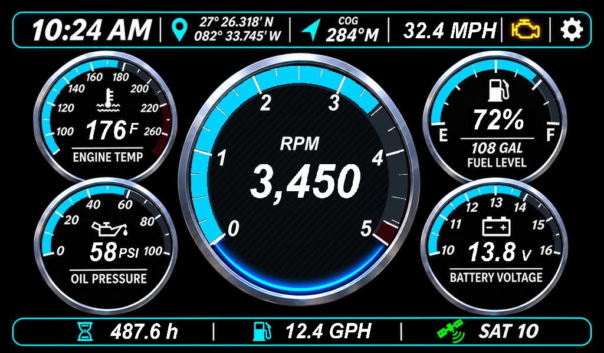

# Boat GaugeCluster

Animated dashboard prototype for the **Waveshare ESP32-S3-Touch-LCD-7B / ESP32-S3-LCD-7B, 1024 x 600**, ESP32-S3 N16R8.



The main reference is `reference/High-Contrast Cyan Automotive Dashboard UI.png`. Its metallic gauge faces and icons are retained as a background asset. Numeric readouts and colored bands are rendered from the same engine values: RPM 0–5000, temperature 100–260 F, oil pressure 0–100 PSI, fuel 0–100%, and voltage 10–16 V. The RPM dial is rebuilt with 0–5 major labels in thousands, minor ticks every 250 RPM, and a redline marker/sector starting at 4800 RPM. The bands fill and drain with the values; unfilled sections are dark and red warning sections brighten only when reached. White ticks and chrome remain visible. Temperature, oil, and voltage use measured tick positions from the artwork, including its nonuniform temperature scale. The generator also saves empty, half, and full band previews in `assets/` for visual verification.

The second image is reserved for future selectable gauges. This version uses simulated engine readings; navigation and status icons are reference artwork, and no NMEA 2000 traffic is read or transmitted. Touch controls the settings popup through the upper-right gear. There is no on-screen demo label; the dashboard extends into the reclaimed bottom space. RPM values below 1000 omit the thousands separator, and speed is centered vertically within the top bar using the visible glyph bounds.

## Gauge alerts

| Gauge | Condition | Appearance |
| --- | --- | --- |
| RPM | Above 4800 RPM | Flash red |
| Engine temperature | Above 200 F | Flash red |
| Oil pressure | Below 15 PSI | Flash red |
| Fuel | Below 20%, but at least 10% | Steady yellow |
| Fuel | Below 10% | Flash red |
| Battery voltage | Below 10 V | Flash red |

Critical alerts pulse the gauge ring, track, and readout red once per second (500 ms red, 500 ms normal), keeping the number visible throughout. Low fuel is yellow during the day and muted amber at night; critical red remains red in night mode. The entire track highlights even for zero fuel or voltage below the dial minimum. Alerts clear automatically on recovery, without changing backlight settings. Comparisons use the underlying reading and are strict: 4800 RPM / 200 F / 15 PSI / 20% / 10 V do not trigger their respective critical/warning thresholds, and exactly 10% fuel is yellow.

`include/gauge_limits.h` defines limits and the shared severity classifier. `src/gauge_limits_checks.cpp` verifies every boundary during compilation. RPM scale assets read the maximum/redline constants from that header so the dial, fill, and alarm agree. The 84-second demo cycle shows RPM overspeed, then high temperature, low oil, yellow fuel, critical fuel, low voltage, and recovery. UART logs report alarm transitions. See [animated alert preview](assets/alerts-preview.gif) and [fuel warning](assets/alerts-fuel-warning.png).

With the demo running and the serial port free, `python tools/check_alarm_runtime.py --port COM9 --seconds 90` observes a full cycle and verifies all critical trigger/recovery events, the fuel warning, and absence of panic/watchdog messages. This checks on-device alert transitions; the generated on/off previews allow separate visual review of flash colors and dial geometry.

## Display settings

Tap the upper-right gear to open settings. Drag the backlight slider from 5% to 100%; the hardware brightness changes while dragging. Tap **NIGHT MODE** to switch the entire dashboard, moving bands, readouts, icons, and settings popup between cyan/day and muted amber/night colors. Night mode initially uses 25% backlight; day mode initially uses 100%. Each mode remembers its own brightness. Preferences are saved to NVS on slider release or mode change and restored at startup. Tap **X**, the gear again, or outside the popup to close it.

The GT911 is reset through EXIO1 with GPIO4 selecting its I2C address. Touch is polled at 20 ms on the existing GPIO8/GPIO9 bus, with a queue separating input from rendering. The backlight uses Waveshare's inverted IO-extension PWM (`100 - brightness`); the 5% minimum keeps the controls visible. If touch initialization fails, the dashboard continues and reports the fault on UART.

Generated previews: [day settings](assets/settings-day-preview.png), [night settings](assets/settings-night-preview.png), and [night dashboard](assets/dashboard-night-preview.png).

## Build and flash

Install Python and PlatformIO Core, then run from this folder:

```powershell
pio run
pio run -t upload --upload-port COM9
pio device monitor --port COM9 --baud 115200
```

The pinned PlatformIO Espressif32 platform installs ESP-IDF and the compiler automatically. Firmware uses 16 MB flash, 8 MB octal PSRAM, RGB565, two panel framebuffers, and Waveshare's panel timing with a conservative 20 MHz pixel clock. Only changing readout regions are restored each frame to reduce PSRAM traffic. UART flashing uses the USB-to-UART connector; the USB native connector shares signals with CAN selection on this board. If automatic bootloader entry fails, hold BOOT, press/release RESET, release BOOT, and retry upload.

## Assets and driver provenance

To regenerate assets, install Pillow (`python -m pip install Pillow`) and run `python tools/generate_assets.py`. The generator uses Windows Arial Bold Italic for its rasterized numeric font; generated assets are committed so ordinary firmware builds need no image tools or fonts. Original reference files are preserved unchanged. The original logical layout's first 570 rows are expanded to 600 physical rows, extending the bottom status bar to the screen edge. Background, text, restore regions, and band masks use the same vertical mapping.

The `src/i2c.*`, `src/io_extension.*`, and `src/rgb_lcd_port.*` hardware drivers come from [Waveshare's official 06_LCD example](https://github.com/waveshareteam/ESP32-S3-Touch-LCD-7B/tree/master/examples/Arduino/examples/06_LCD), upstream commit `c652c902db607f7ffb376257393cfd7657aa6428`. Their license is preserved in `vendor/WAVESHARE-LICENSE`. See [board documentation](https://docs.waveshare.com/ESP32-S3-Touch-LCD-7B).

`src/main.cpp` separates the `EngineData` model and demo producer from drawing. Future work: replace the demo producer with NMEA 2000 PGN handling, missing/stale-data behavior, actual alarms/navigation, and user-selectable gauges. Do not use the simulated display as an engine instrument.
